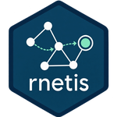

# rnetis



**Network Influence and Selection models, behind one consistent interface.**

Developed and owned by Griffin Dynamics LLC as part of its ongoing research and development.
Licensed under AGPL-3 with additional terms — see [`LICENSE`](LICENSE).

`rnetis` gives applied researchers a single way to specify, fit, diagnose, and report two
established families of social network model:

- **Influence** — a node characteristic changes as a function of its prior state and its
  network exposure to the characteristics of connected others.
- **Selection** — a tie changes as a function of sender, receiver, dyadic, and higher-order
  structural effects, with group-level predictors through a hierarchical model.

Both are well developed in the literature and both are, in practice, awkward to run: they live
in different toolchains, expect different data shapes, and leave exposure construction to
hand-rolled code. This package puts them behind one data structure and one formula grammar.

## What this package contributes

**Unification and usability, more than new methodology.** `rnetis` implements, integrates,
and operationalizes published methods. Every published method is cited on the help page of the
function that computes or fits it (a formula term or option that only feeds such a function is
covered on that function's page), and where an implementation departs from its source, the
departure is named at the function.

A small number of things are this package's own, and each is declared as such where it is
documented:

- the **hierarchical multi-group Selection model** (`?hierarchical_selection`): random
  intercepts and slopes across groups, moderators, correlated random effects, assembled
  from the AME model, hierarchical partial pooling, and half-t and LKJ priors;
- the **latent-scale variance share and null comparison** for AME fits (`?pseudo_r2`,
  `?netis_variance_components`);
- **multi-group `latent()`, which is experimental**: it extends Xu's single-network
  procedure with per-group position coefficients and one shared exposure coefficient, warns
  when used, and is not validated for statistical performance (`?latent`). Separate
  per-network fits are the primary analysis;
- **`add_baseline_provenance()`**, the **assumption ledger** (`?netis_assumptions`), and
  the numeric thresholds in the diagnostics, each stated on its help page as a package
  convention.

The package's tests establish that these are computed as specified. They do not establish
their statistical performance.

## Scope

- **Two waves at most.** `T = 1` and `T = 2`. With three or more waves present, `rnetis`
  requires you to name the wave or the transition rather than choosing one for you.
- **One outcome occasion per unit per fit.** Wave *depth* is unrestricted — lags and exposure
  history may reach further back — but repeated outcome rows per unit are not modeled.
- **Gaussian-continuous Influence outcomes.**

### What is deliberately not here

Dynamic-panel estimators (Arellano–Bond, Blundell–Bond, Bollen–Brand/AMW, the within
transformation), network-HAC standard errors, and distance-shell network autocorrelation are
published methods that fall outside the scope above. They are absent **because of the scope,
not because of any doubt about them.**

## Installation

`rnetis` is not on CRAN and is not published. It is distributed by Griffin
Dynamics LLC at its discretion, to people it gives a copy to.

If you were given a source tarball:

```r
install.packages("rnetis_0.1.0.tar.gz", repos = NULL, type = "source")
```

If you were given access to the repository:

```r
# install.packages("remotes")
remotes::install_github("djgriffin13/rnetis", build_vignettes = TRUE)
```

From a local checkout, `remotes::install_local(".", build_vignettes = TRUE)`,
or `devtools::load_all(".")` for development.

Check that it worked:

```r
library(rnetis)
packageVersion("rnetis")
#> [1] '0.1.0'
```

`rnetis` needs **R 4.1 or later**. That is everything you need for the Influence
workflow. Four required packages come with it — `generics`, `ggplot2`, `lme4`,
`reformulas` — and the install step pulls them from CRAN for you. The package
itself is pure R, so no compiler is needed for it.

### Optional packages, by what they unlock

Nothing below is installed by default, and none of it is needed until you reach
for that capability. `rnetis` will tell you which package to install, by name,
at the point you need it.

| Install | To get |
|---|---|
| `install.packages("amen")` | `fit_selection()` — the Selection model |
| `install.packages(c("latentnet", "RSiena"))` | `latent()` — the latent-space adjustment, and the `s50` data of Xu's example |
| `install.packages(c("sna", "numDeriv"))` | the network-autocorrelation (SAR) estimator |
| `install.packages("clubSandwich")` | cluster-robust standard errors |
| `install.packages(c("igraph", "network"))` | importing from and exporting to `igraph` and `statnet` |

`lame` is used by one corroboration test only, never by the package itself.

To get all of it at once:

```r
install.packages(c("amen", "clubSandwich", "igraph", "lame", "latentnet",
                   "network", "numDeriv", "RSiena", "sna"))
```

Install the full set before running the test suite or `R CMD check`: without it
the tests that need these packages skip silently, and a clean run means much
less than it looks like.

### Building the vignettes

`build_vignettes = TRUE` above builds them. Then:

```r
browseVignettes("rnetis")
```

They need `knitr` and `rmarkdown`, and the full set above.

## A first fit

```r
library(rnetis)

fit <- fit_influence(
  y ~ ar() + exposure(y, via = tie, normalize = "row"),
  data = demo_influence
)
summary(fit)

netis_assumptions(fit)          # what the fit takes for granted
netis_dependence(fit, demo_influence)   # residual dependence, as quantities
```

Four vignettes cover the package: `vignette("influence", package = "rnetis")` builds
a data object and fits an Influence model, `vignette("selection")` fits Selection
models, `vignette("latent-space")` covers the latent space adjustment, and
`vignette("model-fit")` covers checking a model.

## Functions by task

The package is named `rnetis`; its functions and classes use the `netis_` prefix or a plain
name. `?rnetis-package` lists every exported function, and each has its own help page.

| Task | Start with |
|---|---|
| Build a data object | `netis_data()`, `netis_data_from_adjacency()`, `netis_data_from_edgelist()`, `netis_data_from_igraph()`, `netis_data_from_network()` |
| Read or export it | `netis_nodes()`, `netis_ties()`, `netis_adjacency()`, `as_igraph()`, `as_network()` |
| Check data and design | `diagnose_data()`, `diagnose_design()` |
| Construct exposure | `exposure()`, `compute_exposure()`, `bi()` |
| Fit models | `fit_influence()`, `fit_selection()`, `selection_pooling()` |
| Read results | `netis_estimates()`, `netis_glance()`, `tidy()`, `plot_data()` |
| Examine assumptions | `netis_assumptions()`, `netis_dependence()`, `influence_se_comparison()` |
| Report effect sizes | `influence_effect()`, `selection_effect()`, `pseudo_r2()` |
| Aggregation reliability | `icc1()`, `icc2()`, `rwg()`, `rwg_j()` |

## Status

Version 0.1.0, the first complete version. Not on CRAN and not published; distributed by
Griffin Dynamics LLC at its discretion. See [`NEWS.md`](NEWS.md) for what the package does.

The API is stable enough to build on. It is versioned below 1.0 because the package has not
yet been exercised by anyone but its author, and the first outside use is what usually finds
the parts of an interface that were only ever obvious to the person who wrote it.

## Authors

- **Daniel J. Griffin**, Griffin Dynamics LLC — author, maintainer
  ([ORCID](https://orcid.org/0000-0001-5093-3536))

### Collaborators

- **Ajay Somaraju**, SUNY Binghamton
  ([ORCID](https://orcid.org/0000-0001-6441-7233))
- **Ryan Hemsley**, Wayne State University
  ([ORCID](https://orcid.org/0000-0002-1711-6507))

### Acknowledgments

The author acknowledges the **T.A.C.T.I.C.S Lab** (Technology, Adaptation, Coordination, and
Training in Interdependent Complex Systems) at the University of South Florida, and thanks Ken
Frank for his support and insights.

Developed and owned by **Griffin Dynamics LLC** as part of its ongoing research and
development.

## License

Copyright (c) 2026 Griffin Dynamics LLC. Licensed under **AGPL-3, version 3 only, with
additional terms under its section 7**: see [`LICENSE`](LICENSE) for the terms and
[`inst/LICENSE-AGPL-3.md`](inst/LICENSE-AGPL-3.md) for the licence text, which ships with the
package.

The additional terms cover notice and attribution preservation, marking of modified versions
under a different name, publicity, trademarks, indemnification, and warranty and liability. They
apply to the material Griffin Dynamics LLC holds, and **they do not reduce what AGPL-3 gives
you**: if you have a copy, you may use, study, modify and redistribute it on AGPL-3's conditions.

Part of the hierarchical Selection sampler derives from
[`amen`](https://CRAN.R-project.org/package=amen) (Hoff, Fosdick, Volfovsky and He; GPL-3), and
calls `amen` at run time. The GPL-3 terms continue to apply to those parts, and GPL/AGPL
section 13 permits the combination. `inst/COPYRIGHTS` identifies them file by file.
